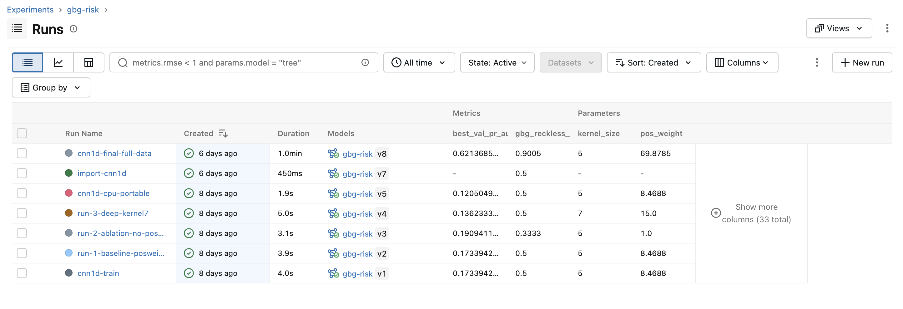
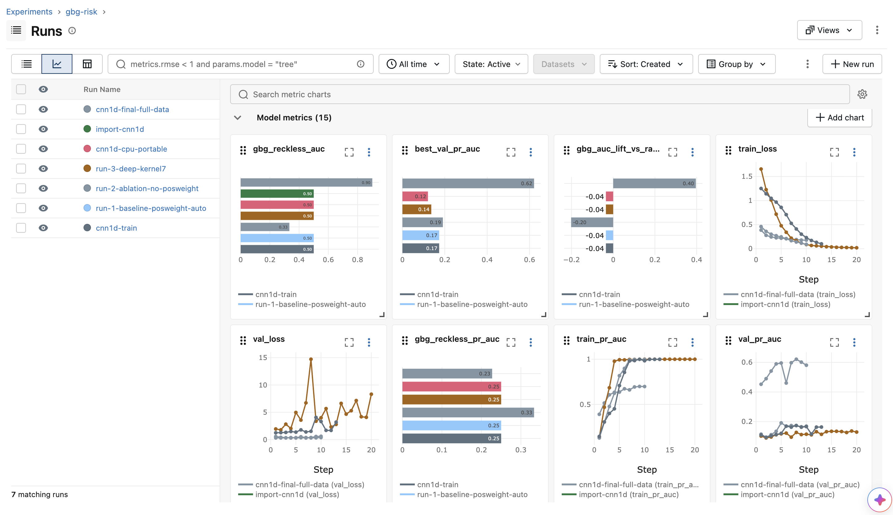
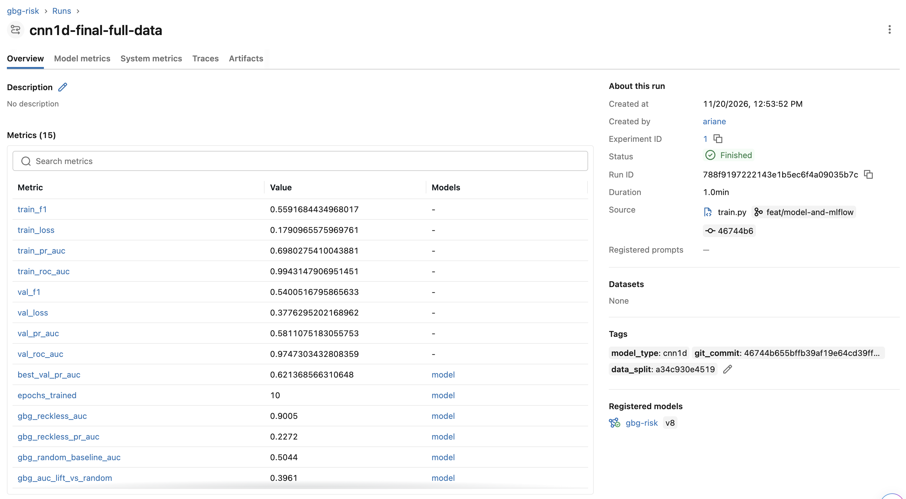
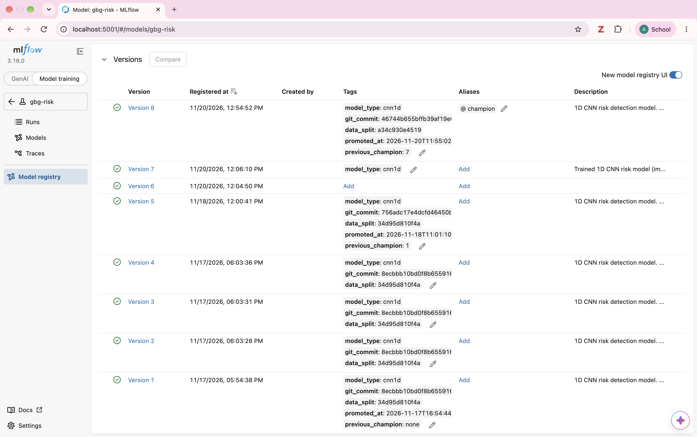

# GBG MLOps : détection de trajets à risque à partir de capteurs IMU

Chaîne MLOps complète autour d'un modèle de deep learning qui note le risque de trajets
de vélo et de trottinette enregistrés par des capteurs inertiels (accéléromètre +
gyroscope, un point toutes les 100 ms).

- **Données d'entraînement** : `SRV3490`, 3 490 trajets dans 8 villes européennes, dont
  698 chutes confirmées.
- **Données d'évaluation** : `GBG500`, 500 trajets à Göteborg ; la classe cible est
  *Reckless* (6 trajets).
- **Modèle** : CNN 1D (PyTorch) sur des fenêtres de 300 points (30 s), pas de 150. Le score
  d'un trajet est le maximum des scores de ses fenêtres.
- **Service** : une API FastAPI charge `gbg-risk@champion` depuis le registre MLflow
  (artefacts sur S3/MinIO) et renvoie un score de risque par trajet ; une web app
  Streamlit permet de déposer un fichier et d'afficher le verdict.

Projet noté du cours MLOps (Albert School). Rendu : 25/11/2026. Soutenance : 26/11/2026.

## Résultat

Évaluation du CNN sur GBG500 (500 trajets, 6 *Reckless*), métrique de promotion
`gbg_reckless_auc` :

| Métrique | Valeur |
|---|---|
| ROC-AUC *Reckless* (`gbg_reckless_auc`) | **0,9005** |
| ROC-AUC d'un score aléatoire (référence) | 0,5044 |
| Gain sur l'aléatoire | +0,3961 |
| PR-AUC *Reckless* | 0,2272 |

Ces chiffres viennent de `gbg_evaluation.json`, produit par `training/evaluate.py` et
enregistré avec le modèle dans MLflow. Avec seulement 6 trajets positifs sur 500, l'AUC
varie beaucoup d'un trajet à l'autre et la PR-AUC reste basse : le résultat est
encourageant, pas une garantie de performance.

Contrôle de bout en bout dans Kubernetes (Docker Desktop, Mac Intel, 23/11/2026) : la web
app donne 0,188 sur un trajet sûr (13 fenêtres, non dangereux) et 0,948 sur un trajet
imprudent (20 fenêtres, dangereux), soit les scores de référence du CNN à l'arrondi près.
Détails dans [`infra/k8s/README.md`](infra/k8s/README.md).

## Expérimentations et registre MLflow

Le suivi des entraînements, l'ablation et la sélection du modèle champion sont tracés sous l'expérience MLflow `gbg-risk`.

### 1. Comparaison des variantes testées
Plusieurs architectures et stratégies de pondération ont été évaluées pour traiter le déséquilibre des classes :
- **Sans pondération (`pos_weight = 1.0`)** : le modèle s'effondre avec un ROC-AUC de 0,33 car il prédit la classe majoritaire.
- **Avec pondération automatique (`pos_weight ~ 70`)** : le modèle apprend efficacement à discriminer les comportements à risque.



### 2. Métriques comparatives et courbes d'apprentissage
Le modèle final (`cnn1d-final-full-data`) dépasse nettement toutes les baselines avec un **ROC-AUC de 0,9005** et une convergence stable de la perte d'entraînement.



### 3. Fiche d'identité du run champion
Traçabilité complète du modèle retenu : hash du commit Git (`46744b6`), empreinte du split des données (`data_split`) et métriques de validation associées.



### 4. Registre de modèles (Model Registry)
Gestion du cycle de vie sous `gbg-risk` : la version 8 a été promue avec l'alias officiel **`@champion`** pour être chargée automatiquement par l'API FastAPI et le cluster Kubernetes.



## Architecture

```mermaid
flowchart LR
    RAW[(data/raw<br>SRV3490, GBG500)] --> PIPE[pipelines/<br>ingest + prepare]
    PIPE --> NPZ[(data/processed<br>*.npz + normalization.json)]
    NPZ --> TRAIN[training/<br>CNN 1D]
    TRAIN --> MLF[MLflow<br>suivi + registre]
    MLF --> S3[(MinIO<br>s3://mlflow)]
    MLF -->|gbg-risk@champion| API[api/<br>FastAPI]
    API --> APP[app/<br>web app Streamlit]
    GH[GitHub Actions<br>CI puis CD] -->|images SHA + latest| HUB[(Docker Hub)]
    HUB -->|runner auto-hébergé| K8S[Kubernetes<br>Docker Desktop]
    K8S --- API
    K8S --- APP
```

Détail des composants et des flux : [`docs/architecture.md`](docs/architecture.md).
Comment lancer, entraîner, déployer et revenir en arrière :
[`docs/operations.md`](docs/operations.md).

## Équipe

| Membre | Réalisé |
|---|---|
| Mathilde | Dépôt et contrats, Docker Compose de développement, modèle factice, API FastAPI, registre + S3, promotion et rollback du modèle, export d'un trajet pour la démo |
| Lucas | Ingestion, préparation des données (découpage par groupe, normalisation), DAG Prefect |
| Ariane | CNN 1D (PyTorch), suivi MLflow, évaluation sur GBG500, import du modèle exporté dans le registre |
| Emma | Image API multi-stage, manifestes Kubernetes (API, MLflow, MinIO, PostgreSQL), correctifs Mac Intel et ARM, validation sur Kubernetes |
| Laura | CI (lint, tests, build des images), CD (Docker Hub + déploiement par runner auto-hébergé), web app Streamlit et son déploiement Kubernetes, tests de bout en bout |

## Démarrage rapide

Prérequis : Python 3.12, [uv](https://docs.astral.sh/uv/), Docker Desktop.
Les données brutes ne sont pas dans Git : placer `SRV3490.parquet`, `GBG500.parquet` et
`GBG500_labels.csv` dans `data/raw/`.

```sh
make install        # .venv avec les dépendances API + dev
make lint           # ruff
make test           # tests unitaires + intégration (sans serveur)
make up             # pile de dev : Postgres, MinIO, MLflow, API, Prefect (crée .env si absent)
make dummy-model    # enregistre gbg-risk@champion (modèle factice) et recharge l'API
curl localhost:8000/health
make down           # arrête la pile ; les données restent dans des volumes nommés
```

`make help` liste toutes les commandes.

### Pipeline de données

```sh
make data           # data/raw/ → data/processed/{train,val,test,gbg_eval}.npz, normalization.json, split.json
make data-sample    # idem sur 50 groupes, dans data/processed/sample/ (essais rapides)
make ingest         # data/raw/* → bucket MinIO raw, chaque objet étiqueté par son SHA-256
make dag            # DAG Prefect : ingest → prepare → train → evaluate → promote (après make up)
```

`make data` lit SRV3490 ville par ville avec DuckDB, nettoie et découpe chaque trajet en
fenêtres avec `features.py`, sépare par groupe (un trajet de chute + ses 4 trajets de
référence, 70/15/15, graine 42) et ajuste la normalisation sur le train uniquement.

### Entraînement

```sh
uv sync --group training   # PyTorch n'a pas de wheel pour Mac Intel : entraîner sur Apple Silicon ou en conteneur Linux
make train                 # entraîne le CNN et l'enregistre dans MLflow (sans toucher à champion)
make compare-runs          # compare 3 variantes dans MLflow
make promote VERSION=N     # promeut la version N seulement si son gbg_reckless_auc est meilleur
```

### Services de la pile de dev

| Service | URL | Identifiants (dev seulement) |
|---|---|---|
| API (Swagger) | http://localhost:8000/docs | n/a |
| MLflow | http://localhost:5001 | n/a |
| Console MinIO | http://localhost:9001 | `AWS_ACCESS_KEY_ID` / `AWS_SECRET_ACCESS_KEY` de `.env` |
| Prefect (DAG) | http://localhost:4200 | n/a |

MLflow est sur 5001 car macOS réserve le port 5000 à AirPlay. Tous les ports hôte se
changent dans `.env`.

### Noter un trajet

```sh
# JSON : de 300 à 20 000 échantillons toutes les 100 ms ; null = valeur manquante
curl -X POST localhost:8000/predict -H "Content-Type: application/json" -d @ride.json

# Fichier : un trajet, colonnes time_index, ax, ay, az, rx, ry, rz (CSV ou Parquet)
uv run python scripts/export_ride.py --list Reckless           # identifiants de trajets d'un label GBG500
uv run python scripts/export_ride.py --ride-id <id> --out data/demo/ride.csv
curl -X POST localhost:8000/predict/file -F file=@data/demo/ride.csv -F units=deg_s
```

```json
{"prediction_id": "05edde9c-…", "ride_id": "bc3a3597…", "risk_score": 0.05,
 "is_reckless": false, "threshold": 0.5, "predicted_class": null,
 "model_name": "gbg-risk", "model_version": "2", "n_windows": 24}
```

`units` est obligatoire : `deg_s` pour GBG500, `rad_s` pour SRV3490. Contrat complet :
[`CONTRACTS.md`](CONTRACTS.md).

## Déploiement

- **Kubernetes (Docker Desktop)** : API, web app, MLflow, MinIO et PostgreSQL dans le
  namespace `gbg-mlops`. Procédure : [`infra/k8s/README.md`](infra/k8s/README.md).
- **CI** : lint, tests et build des images sur chaque PR
  ([`.github/workflows/ci.yml`](.github/workflows/ci.yml)).
- **CD** : après une CI verte sur `main`, publication de `gbg-api` et `gbg-app` (amd64 +
  arm64) sur Docker Hub, taguées par SHA de commit et `latest`, puis déploiement sur la
  machine de démo par un runner auto-hébergé, tests de bout en bout et retour aux images
  précédentes en cas d'échec ([`.github/workflows/cd.yml`](.github/workflows/cd.yml),
  [`docs/runner.md`](docs/runner.md)). L'étape de déploiement n'est active que si la
  variable de dépôt `DEPLOY_ENABLED` vaut `true`.
- **Changer de modèle** : `make promote VERSION=N` (refusé si le modèle est moins bon),
  `make rollback` pour revenir à la version précédente
  ([`docs/model-promotion.md`](docs/model-promotion.md)).

## Limites connues

- Pas de chart **Helm** : le déploiement Kubernetes utilise des manifestes simples.
- Pas de **monitoring** (Prometheus, Grafana) ni de **réentraînement automatique**.
- Le **DAG Prefect** enchaîne ingestion, préparation, entraînement, évaluation et
  promotion, mais son exécution complète avec le vrai entraînement n'a pas été validée ;
  Prefect n'est pas déployé dans Kubernetes (pile de dev Compose seulement).
- L'**image MLflow** se construit en local (`imagePullPolicy: Never`) : elle n'est pas
  publiée sur Docker Hub.
- Le modèle n'est pas dans Git : il s'importe dans le registre avec
  `scripts/register_exported_model.py`, et un nouveau registre est vide.
- Le résultat repose sur **6 trajets positifs** dans GBG500 (voir Résultat).
- L'exécution sur Apple Silicon reste à confirmer ; la validation Kubernetes a été faite sur
  Mac Intel.

## Organisation du dépôt

| Chemin | Contenu | Responsable |
|---|---|---|
| `src/gbg_mlops/` | Paquet partagé : réglages, prétraitement, schémas API, chargement du modèle, CNN | Mathilde (features : Lucas) |
| `api/` | Application FastAPI et son Dockerfile | Mathilde (Dockerfile : Emma) |
| `pipelines/` | Ingestion, préparation, DAG Prefect | Lucas |
| `training/` | Entraînement et évaluation du CNN | Ariane |
| `infra/k8s/` | Manifestes Kubernetes | Emma |
| `app/` | Web app Streamlit et son Dockerfile | Laura |
| `.github/workflows/` | CI et CD | Laura |
| `scripts/` | Promotion, rollback, export d'un trajet, enregistrement de modèles | Mathilde (import du CNN : Ariane) |
| `docker/` | Images de dev (serveur MLflow) | Mathilde |
| `tests/` | `unit/`, `integration/`, `e2e/` | tous |
| `docs/` | Documentation | tous |

## Contribuer

- Ne jamais pousser sur `main` : une branche par fonctionnalité, des commits petits et
  explicites, une PR relue par une autre personne.
- Les interfaces entre composants sont fixées dans [`CONTRACTS.md`](CONTRACTS.md) ; on ne
  les change que par une PR vue par toute l'équipe.
- Ni donnée, ni modèle, ni `.env`, ni secret dans Git.
