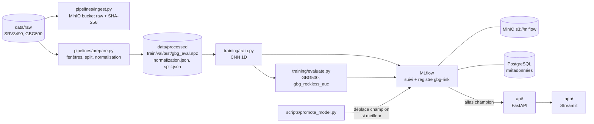

# Architecture

Ce document décrit les composants du projet et le chemin d'une donnée, du fichier brut
au score affiché dans la web app. Les interfaces exactes entre composants sont dans
[`../CONTRACTS.md`](../CONTRACTS.md).

## Vue d'ensemble

Le DAG Prefect (`pipelines/dag.py`) enchaîne ingestion, préparation, entraînement,
évaluation et promotion.

## Les composants

| Composant | Rôle | Dossier |
|---|---|---|
| Préparation des données | Nettoie chaque trajet, convertit le gyroscope en rad/s, découpe en fenêtres de 300 points (pas de 150), sépare train/val/test par groupe, calcule la normalisation sur le train seulement | `pipelines/`, `src/gbg_mlops/features.py` |
| Entraînement | CNN 1D PyTorch, perte pondérée contre le déséquilibre de classes, arrêt anticipé, graine fixe ; chaque exécution est suivie dans MLflow | `training/`, `src/gbg_mlops/model.py` |
| Évaluation | Score d'un trajet = maximum de ses fenêtres ; ROC-AUC de *Reckless* sur GBG500 enregistrée comme `gbg_reckless_auc` | `training/evaluate.py` |
| Registre MLflow | Versions du modèle `gbg-risk` ; l'alias `champion` désigne la version servie | MLflow |
| Stockage | MinIO (S3) pour les artefacts du modèle et la normalisation, PostgreSQL pour les métadonnées | MinIO, PostgreSQL |
| Promotion | Déplace `champion` vers une version seulement si son `gbg_reckless_auc` est strictement meilleur ; `rollback` revient à la version précédente | `scripts/promote_model.py` |
| API | Charge `gbg-risk@champion` au démarrage, applique la normalisation, découpe en fenêtres, renvoie un score par trajet | `api/`, `src/gbg_mlops/` |
| Web app | Dépôt d'un fichier, appel de l'API, affichage du verdict et de la version du modèle | `app/` |

## Choix de conception

- **Les unités du gyroscope diffèrent** entre SRV3490 (rad/s) et GBG500 (°/s, environ 57
  fois plus grand). Tout est converti en rad/s avant le modèle ; l'API exige le paramètre
  `units`.
- **Pas de fuite entre train et test** : un trajet de chute et ses 4 trajets de référence
  forment un groupe, et un groupe n'est jamais séparé entre les jeux.
- **La normalisation est calculée sur le train seulement** et enregistrée avec le modèle
  (`normalization.json`) ; le modèle lui-même ne normalise pas.
- **Un nouvel entraînement ne change pas le modèle servi.** Il enregistre une version ;
  seule la promotion déplace `champion`, et elle refuse un modèle moins bon.
- **L'image de l'API ne contient pas le modèle** : elle le charge depuis le registre au
  démarrage. Changer de modèle = déplacer l'alias puis redémarrer l'API.
- **Contrats d'abord** : chaque propriétaire de dossier pouvait avancer seul grâce aux
  interfaces fixées dans `CONTRACTS.md` et à un modèle factice servi dès le début.

## Environnements

| | Développement (Docker Compose) | Démonstration (Kubernetes) |
|---|---|---|
| Services | Postgres, MinIO, MLflow, API, Prefect | Postgres, MinIO, MLflow, API, web app |
| Images | construites en local | `gbg-api` et `gbg-app` publiées sur Docker Hub (amd64 + arm64, tag = SHA du commit) ; MLflow construit en local |
| Lancement | `make up` | [`../infra/k8s/README.md`](../infra/k8s/README.md) |
| Accès | ports de l'hôte (8000, 5001, 9001, 4200) | `kubectl port-forward` (API 8001, app 8502, MLflow 5001) |

## Intégration et déploiement continus

1. Sur chaque PR, la CI (`.github/workflows/ci.yml`) lance le lint, les tests et le build
   des images sans les publier.
2. Après une CI verte sur `main`, le CD (`.github/workflows/cd.yml`) publie `gbg-api` et
   `gbg-app` sur Docker Hub avec deux tags : le SHA du commit et `latest`.
3. Si la variable de dépôt `DEPLOY_ENABLED` vaut `true`, un runner auto-hébergé sur la
   machine de démo met à jour les Deployments `api` et `app`, attend leur déploiement,
   lance les tests de bout en bout, puis vérifie que la web app répond. En cas d'échec, il
   remet les images précédentes.

Le runner est nécessaire parce que les serveurs de GitHub ne peuvent pas joindre le
Kubernetes d'un ordinateur portable. Voir [`runner.md`](runner.md).
